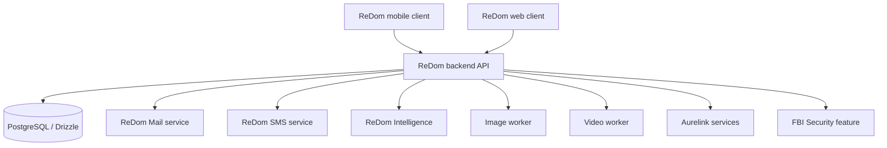

ReDom is organized as a monorepo with separate client applications, backend services, worker processes, and shared packages. The repository structure is the starting point for understanding ownership; runtime communication and deployment status must be confirmed from the service configuration.

## System boundaries

<Note>This diagram is a repository-level conceptual map. It does not claim that every arrow is an active production network connection. Confirm actual service URLs, queues, credentials, and deployment settings from the source and hosting configuration.</Note>

## Core application boundaries

- Mobile client: `artifacts/redom-frontend/`
- Web client: `artifacts/redomweb/`
- Main backend: `artifacts/redom-backend/`
- Shared database package: `lib/db/`
- Shared API packages: `lib/api-client-react/`, `lib/api-spec/`, and `lib/api-zod/`

## Worker and service boundaries

Dedicated service directories exist for mail, SMS, intelligence, image generation, and video generation. Each service has its own entry points and supporting configuration. Read its README and runtime manifest before assuming how it is deployed.
